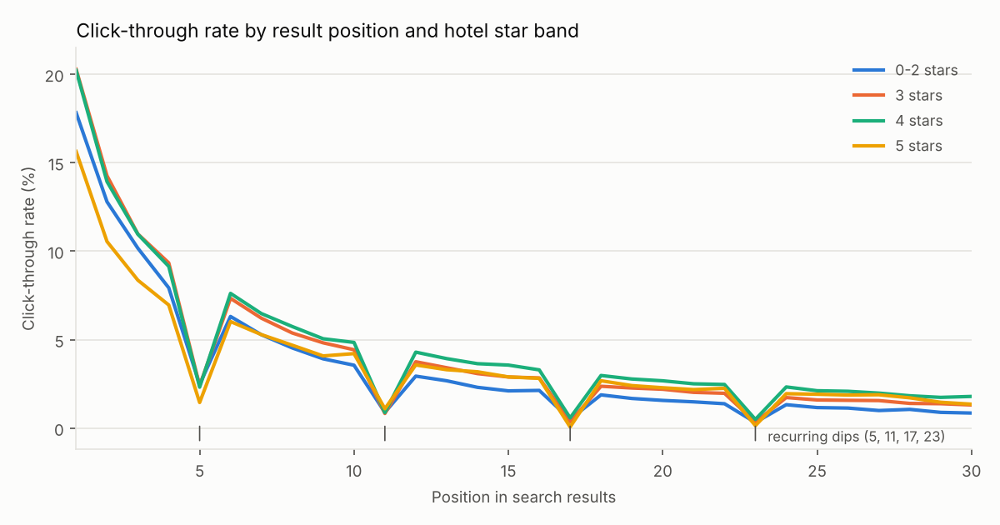
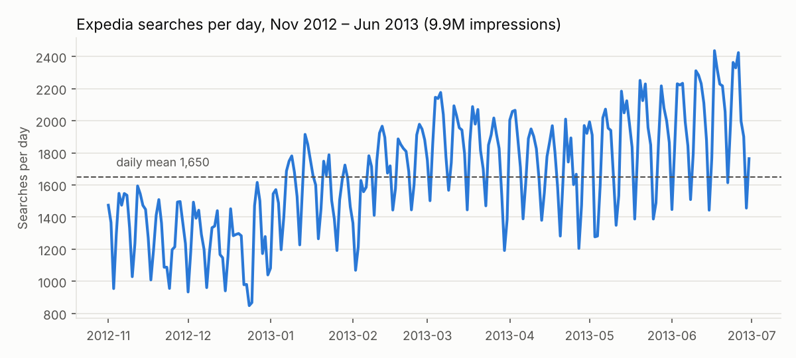

# Spark big-data analytics: batch, graph and streaming

Four Apache Spark pipelines from my MSc Big Data Processing module (Queen Mary University of London, 2026, individual coursework). Each one covers a different kind of large-scale processing:

| Task | Data | Scale | What it covers |
|---|---|---|---|
| [1. Expedia search analytics](src/task1_expedia_search.py) | Expedia hotel search logs | **9.9M** impressions, 399K searches | DataFrame API, time features, window functions (`row_number` top-N per month), click-through and conversion rates |
| [2. Amazon book reviews](src/task2_amazon_book_reviews.py) | Amazon Books reviews + metadata | **3.0M** reviews | Cleaning Unix timestamps, joins, `lag()` year-on-year growth, category and reviewer analysis |
| [3. NYC taxi graph](src/task3_nyc_taxi_graph.py) | 2023 NYC yellow-taxi trips | **22.4M** trips → 265 zones, 40,155 routes | GraphFrames: connected components, degrees, triangle count, BFS, shortest paths, PageRank, label propagation |
| [4. IoT smoke-detection stream](src/task4_iot_streaming.py) | Live sensor stream over a socket | continuous | Structured Streaming: watermarks, tumbling and sliding windows, output modes, triggers, memory sink, checkpoint recovery |

`PySpark` · `Spark SQL / DataFrame API` · `GraphFrames` · `Structured Streaming` · `S3 (s3a)` · `pandas` · `matplotlib`

The jobs ran on the module's Spark cluster, reading from S3 and checked against the Spark History Server. The [`results/`](results) folder holds the CSVs they exported.

---

## Highlights

### Position bias in search results (Task 1)



- **Click-through rate falls sharply with position.** It is around 18–20% at position 1 and about 4% by position 10.
- **3- and 4-star hotels get clicked more** than 0–2 and 5-star hotels at almost every position.
- **CTR dips at positions 5, 11, 17 and 23,** every sixth result. This is probably a page-layout effect, such as the point where users have to scroll or change page, rather than anything about the hotels.



Search volume (November 2012 to June 2013) rises steadily from winter into summer, with a weekly cycle. Task 1 flags every day above the daily mean of 1,650 searches.

### Taxi zones as a graph (Task 3)

- **Graph:** 22.4M trips become a directed graph with zones as vertices and trips as edges. Deduplicating trips gives **40,155 unique routes**.
- **Connectivity:** 263 of the 265 zones form a single connected component.
- **PageRank:** classic PageRank (reset probability 0.15) ranks JFK, LaGuardia and Manhattan zones such as East Harlem South and Lenox Hill East highest.
- **Frequency-aware PageRank:** the cluster's GraphFrames version had no `weightCol`, so this version runs on the raw trip edges. Busy routes then count once per trip, which weights them naturally.
- **Also included:** BFS and `shortestPaths` reachability, and label propagation for communities, with each community's borough mix.

### Streaming (Task 4)

- **Ingestion:** the stream is parsed from a live socket with a **5-second watermark**.
- **Windows:** 10-second tumbling windows, and 1-minute windows sliding every 30 seconds.
- **Alarm state:** counted with state across batches in `complete` mode, using processing-time triggers.
- **Evaluation:** a window-level check of whether TVOC alerts predict high-risk readings. It computes a confusion matrix, precision and recall per micro-batch, via a memory sink. In batch 4: precision 1.0, recall 0.67.
- **Recovery:** checkpoint recovery is demonstrated. The query was stopped after batch 4 and restarted from the same checkpoint, then resumed at batch 5 with the running count (71) restored.

---

## Problems I hit at scale, and how I fixed them

| Problem | Cause | Fix |
|---|---|---|
| `StackOverflowError` in `connectedComponents()` | Iterative graph algorithms build a very long lineage | Set a checkpoint directory (`setCheckpointDir`) so Spark cuts the lineage between iterations |
| Out-of-memory during `triangleCount()` on 22M edges | Massive shuffle across every raw trip edge | Ran it on the **deduplicated route graph (~40K edges)** with `StorageLevel.MEMORY_AND_DISK`, so excess data spills to disk |
| Repeated slow reads from S3 | Each action re-ran the whole plan from the source | Cached the base vertex and edge DataFrames after the first action |
| No `weightCol` for PageRank on the cluster | Older GraphFrames version | Kept the repeated trip edges, so frequent routes carry more weight in the random walk |
| `NumberFormatException` on the live stream | The emulator re-sent header rows and partial packets | Filtered malformed rows before casting |
| `StackOverflowError` computing metrics inside `foreachBatch` | Complex logic inside the streaming sink | Wrote aggregates to a **memory sink** and queried that table between batches |
| "Offsets committed out of order" after restart | A socket source can't be replayed, so offsets reset on reconnect | Documented as a limitation: checkpointed state was restored, but exactly-once recovery needs a replayable source such as Kafka or files |

---

## Running it

The scripts were written for the cluster, where input and output buckets come from environment variables. To run them on a laptop, point the same variables at local files:

```bash
pip install -r requirements.txt

# Task 1 (Expedia CSV)
HOTELS_PATH=data/hotels.csv OUTPUT_PATH=out/task1 python src/task1_expedia_search.py

# Task 2 (Amazon Books reviews + metadata)
RATINGS_PATH=data/Books_rating.csv BOOKS_PATH=data/books_data.csv OUTPUT_PATH=out/task2 \
  python src/task2_amazon_book_reviews.py

# Task 3 needs the GraphFrames package
TRIPS_PATH=data/yellow_tripdata/ ZONES_PATH=data/taxi_zone_lookup.csv \
OUTPUT_PATH=out/task3 CHECKPOINT_DIR=out/checkpoints \
  spark-submit --packages graphframes:graphframes:0.8.4-spark3.5-s_2.12 src/task3_nyc_taxi_graph.py
```

Notes:
- **Tasks 1 and 2** have been checked locally on sample extracts (about 1M Expedia rows and an Amazon reviews sample) with PySpark 3.5.
- **Task 4** reads the module's live sensor emulator over a socket, so it needs a stream in the same CSV format on `STREAMING_SERVER_SMOKE` / `STREAMING_SERVER_SMOKE_PORT`.
- **The datasets are not in this repo.** They are public: the Expedia hotel searches and Amazon Books reviews datasets on Kaggle, and the NYC TLC trip records.

## Layout

```
src/        one script per task, organised Q1, Q2, … as in the brief
results/    CSV outputs exported from the cluster runs
docs/       figures built from those CSVs
```
